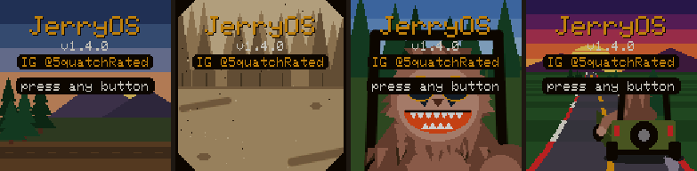
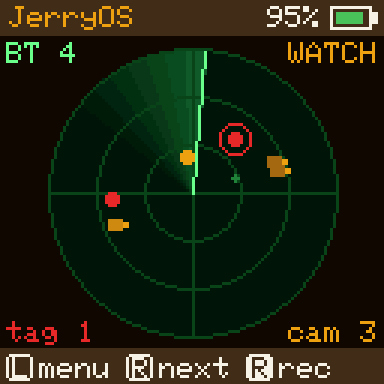
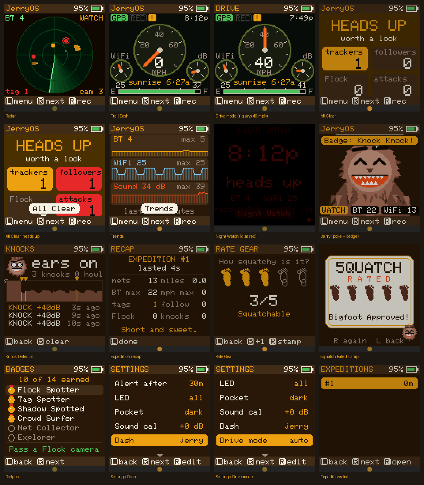
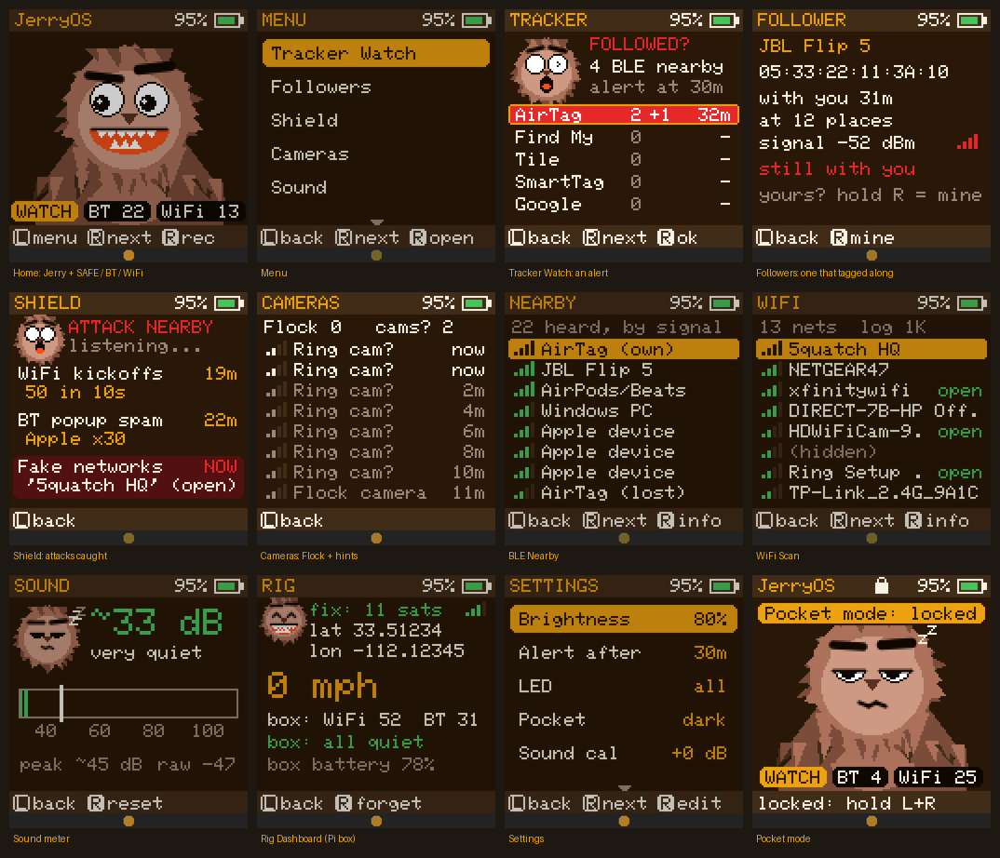

# JerryOS

**Free custom firmware that turns the AIPI Lite into Jerry the Squatch: a
pocket-sized, listen-only privacy monitor with a funky attitude.**

By [5quatch Rated](https://5quatchrated.com) · Instagram
[@5quatchRated](https://instagram.com/5quatchRated) · Jerry is our "Chief
Gear Inspector".


The AIPI Lite is a little ESP32-S3 gadget with a 128×128 screen, two buttons,
a microphone and a speaker. Flash JerryOS onto it and it becomes:

- **Tracker Watch:** AirTags, Tiles, SmartTags and other item trackers that
  have been travelling with you, away from their owner.
- **Followers:** any Bluetooth device that keeps showing up wherever you go.
- **Shield:** Wi-Fi "kick-off" floods, Flipper-style Bluetooth pop-up spam,
  evil-twin and fake networks.
- **Cameras:** Flock licence-plate cameras as you pass them, plus
  hidden-camera hints for hotel and rental checks.
- **Six home dashes:** Jerry himself, a **Radar** sweep, a Jeep-style **Trail
  Dash** (speed, gauges, battery as the fuel gauge), **All Clear**, 10-minute
  **Trends**, and a dim red **Night Watch**.
- **Knock Detector:** listens for wood knocks and howls. Knock on a tree and
  see if the woods knock back.
- **Expeditions:** a recap card for every recording session.
- **Rate Gear:** the **5quatch Rated** stamp, rate your gear 1-5 squatch
  prints on camera.
- **Badges**, a **sound meter**, **BLE / Wi-Fi scanners**, a silent
  **colour LED**, **pocket mode**, and four boot intros, each with its own
  funk groove.

## Quick start

1. Get an **AIPI Lite** and a USB-C data cable.
2. **Back up** the stock firmware, then **flash** the newest file in
   [`firmware/`](firmware/) ([how](#install), about 2 minutes).
3. Power on: Jerry plays an intro. **Press any button.**
4. **Tap R** on the home screen to flip between the dashes. **Tap L** for the
   menu. The bottom bar always shows what each button does.
5. Read the **[user guide](docs/USER-GUIDE.md)** for everything else.

## A tour

**Four boot intros, each with its own funk groove** (random each time, or pick
one in Settings): Jeep Jam, Bluff Creek, Selfie and Cruisin'. Watch them with
sound in [docs/previews](docs/previews/).



**The home dashes.** Tap R on the home screen to flip between them:

| Radar | 5quatch Rated stamp |
|---|---|
|  |  |



**The menu modes:**



## Listen-only, by design

- Jerry **never transmits**. He only listens to what's already in the air:
  no jamming, no deauth, no probing, no connecting to anything.
- He **saves nothing** unless you press REC, and what he saves stays on the
  device until you copy it off.
- He's a helpful second pair of eyes, **not a guarantee**. Phones and AirPods
  change their Bluetooth address every ~15 minutes on purpose, a camera that
  records to a card is radio-silent, and the "knocks" are possible knocks.
  The [user guide](docs/USER-GUIDE.md) lists the honest limits.
- Know your local laws on Wi-Fi / Bluetooth monitoring and recording before
  you use it.

## What you need

- An **AIPI Lite** (ESP32-S3, 16 MB flash, 8 MB PSRAM). It stays physically
  stock: no soldering, no opening it up (normally).
- A USB-C data cable and a computer (Windows, macOS or Linux).
- Optional: a Raspberry Pi Zero "rig box" with GPS for speed, location,
  the time and sunrise / sunset ([tools/pi](tools/pi/README.md)).

## Install

The ready-made firmware is in [`firmware/`](firmware/): use the newest
`jerryos-cp*.bin` (the highest number; `cp18` is v1.4.0). Each has a
`.sha256` file to check it against.

### 1. Back up your original firmware first

Your backup stays on your own computer: it can contain the Wi-Fi password
you gave the stock app, so never share it. With it you can always go back
to stock.

**Windows** (in this folder, in PowerShell):

```powershell
powershell -ExecutionPolicy Bypass -File tools\backup_firmware.ps1
```

**macOS / Linux** (`pip install esptool` first; your port looks like
`/dev/cu.usbmodem...` on a Mac, `/dev/ttyACM0` on Linux):

```bash
esptool --chip esp32s3 --port /dev/ttyACM0 read-flash 0 0x1000000 aipi-backup.bin
```

### 2. Flash JerryOS

**Windows:**

```powershell
powershell -ExecutionPolicy Bypass -File tools\flash_prebuilt.ps1 -Port COM7
```

(Your COM port may differ: leave `-Port` off and it finds the device.)

**macOS / Linux:**

```bash
esptool --chip esp32s3 --port /dev/ttyACM0 write-flash 0x0 firmware/jerryos-cp18-dashes.bin
```

(esptool v4 and older spell these `read_flash` / `write_flash`.)

If esptool can't connect, see
[backup/README.md](backup/README.md#if-esptool-cannot-connect).

### 3. Going back to stock

Windows: `tools\restore_firmware.ps1`. Elsewhere:
`esptool --chip esp32s3 --port <port> write-flash 0x0 aipi-backup.bin`.

## Using Jerry

Tap **L** = menu / back, tap **R** = next (on the home screen: the next dash),
hold **R** = select (on home: REC), hold **L** = home, hold **L + R** =
pocket mode. The bottom bar always shows what the buttons do.

Everything else is in the **[user guide](docs/USER-GUIDE.md)**.

## Build it yourself

- **Firmware:** `tools/build_firmware.sh firmware/my-build.bin` (Linux,
  macOS, WSL) with arduino-cli, Arduino-ESP32 **2.0.17**, NimBLE-Arduino
  **1.4.3** and LovyanGFX **1.2.7**. The script's header lists the
  one-time setup. The exact versions matter.
- **PC simulator:** `tools/sim/build_sim.sh <path to LovyanGFX>` runs the
  real screens on your computer and saves screenshots, GIFs and videos.
- **Unit tests:** `tools/sim/run_tests.sh` (289 checks, no device needed).
- **Hear the grooves:** `tools/sim/render_funk.sh`, or just play
  [docs/sounds](docs/sounds/).

Code map: `src/main.cpp` explains where everything lives. The whole build
story, checkpoint by checkpoint, is in [BUILDLOG.md](BUILDLOG.md).

## Repo layout

```
backup/      where YOUR firmware backup goes (never in git)
docs/        user guide, hardware notes, checkpoint guides, previews, sounds
firmware/    ready-to-flash builds (+ SHA256)
include/     board_pins.h: every pin in one place
src/         the firmware
tools/       build, backup, restore, flash, log-pull scripts; PC simulator + tests (tools/sim);
             the Pi rig box beacon (tools/pi)
BUILDLOG.md  the build diary
```

## License

JerryOS is **free for noncommercial use** under the
[PolyForm Noncommercial License 1.0.0](LICENSE.md): use it, change it, share
it, build on it. **Selling it**, or using it in a paid product or service,
needs written permission from 5quatch Rated: get in touch through
[5quatchrated.com](https://5quatchrated.com) or
[@5quatchRated](https://instagram.com/5quatchRated).

The open-source libraries inside the firmware keep their own licenses: see
[THIRD_PARTY_NOTICES.md](THIRD_PARTY_NOTICES.md).

### The brand

"Jerry the Squatch", "5quatch Rated", and Jerry's look and character are
5quatch Rated's own and are **not** covered by the license. If you share a
modified version, give it your own name and character. Telling people it's
based on JerryOS, with a link back here, is welcome.

## Build history

| # | Checkpoint | State |
|---|---|---|
| 1 | Firmware backup confirmed | ✅ 2026-10-04 |
| 2 | Hello world: screen, buttons, battery, serial log | ✅ 2026-10-04 |
| 3 | JerryOS shell: home, menu, hint bar, modes (placeholder faces) | ✅ 2026-10-05 |
| 4 | Tracker Watch + BLE Nearby | ✅ 2026-10-05 ([guide](docs/CHECKPOINT4.md), [how it works](docs/TRACKERS.md)) |
| 5 | Wi-Fi scanner + logger | ✅ 2026-10-05 ([guide](docs/CHECKPOINT5.md)) |
| 6 | Personal monitor: home screen, REC, screen saver | ✅ 2026-10-06 ([guide](docs/CHECKPOINT6.md)) |
| 7 | Followers: any Bluetooth device that moves with you | 🟡 home test ✅, drive test pending ([guide](docs/CHECKPOINT7.md)) |
| 8 | Shield: Wi-Fi kick-offs, Bluetooth pop-up spam, fake networks | ✅ quiet-day test 2026-10-07 ([guide](docs/CHECKPOINT8.md)) |
| 9 | Colour LED as a silent signal | ✅ 2026-10-07 ([guide](docs/CHECKPOINT9.md)) |
| 10 | Flock licence-plate cameras | 🟡 home ✅, drive-by pending ([guide](docs/CHECKPOINT10.md)) |
| 11 | Hidden-camera hints (hotel / rental check) | 🟡 ready to test ([guide](docs/CHECKPOINT11.md)) |
| 12 | Pocket mode + sound meter | ✅ 2026-10-07 ([guide](docs/CHECKPOINT12.md)) |
| 13 | **v1.0:** Rig Dashboard (Pi beacon), GPS-tagged logs, reset, user guide | ✅ boots 2026-10-08, field tests ongoing ([guide](docs/CHECKPOINT13.md)) |
| 14 | **v1.1:** boot intro (Jerry drives off in his Jeep), "JerryOS" title | ✅ 2026-10-08 |
| 15 | **v1.2:** funk boot groove (Bootsy-style, [hear it](docs/sounds/intro_funk.wav)) | ✅ "the groove is jamming" 2026-10-08 |
| 16 | **v1.2.1:** quieter, cleaner groove; Intro tune off / low / med / high | ✅ "volume sounds way better" 2026-10-08 |
| 17 | **v1.3:** intros Bluff Creek, Selfie, Cruisin' (each with its own groove, [previews](docs/previews/)); Settings → Intro | ✅ "absolutely perfect" 2026-10-08 |
| 18 | **v1.4:** home dashes (Radar, Trail Dash, All Clear, Trends, Night Watch), drive mode, Knock Detector, Expeditions, Rate Gear stamp, Badges, sunrise / sunset ([previews](docs/previews/v1.4_screens.png)) | ✅ released 2026-11-24 |

## Credits

Pin maps and hardware notes come from people who reverse-engineered the AIPI
Lite before us. Full details are in [docs/HARDWARE.md](docs/HARDWARE.md#sources-thank-you).

- delacerda-mrd: [Claude-Monitor-AiPi-Lite](https://github.com/delacerda-mrd/Claude-Monitor-AiPi-Lite) board reference
- DaveMath / @GGDM: [flock-you-go](https://github.com/DaveMath/flock-you-go)
- sticks918: [AIPI-Lite-ESPHome](https://github.com/sticks918/AIPI-Lite-ESPHome)
- bcarroll: [aipi-lite-minitv](https://github.com/bcarroll/aipi-lite-minitv)
- Robert Lipe's AIPI-Lite teardown
- Espressif: [esptool](https://github.com/espressif/esptool), [Arduino-ESP32](https://github.com/espressif/arduino-esp32)
- lovyan03: [LovyanGFX](https://github.com/lovyan03/LovyanGFX)
- h2zero: [NimBLE-Arduino](https://github.com/h2zero/NimBLE-Arduino)
- SEEMOO lab, TU Darmstadt: [AirGuard](https://github.com/seemoo-lab/AirGuard) (tracker signatures)
- colonelpanichacks: [flock-you](https://github.com/colonelpanichacks/flock-you) (MIT), DaveMath:
  flock-you-go, @NitekryDPaul (Flock camera signatures)
