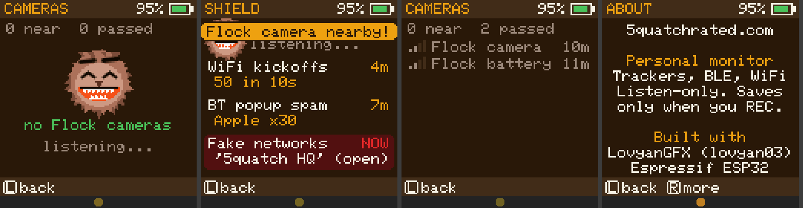

# Checkpoint 10: Flock licence-plate cameras

Jerry now spots **Flock Safety** licence-plate (ALPR) cameras, their
"Penguin" battery packs and Raven gunshot sensors by their radio
fingerprints, and tells you as you pass one. Listen-only.


*Simulator: no cameras yet → the "Flock camera nearby!" message popping up
over whatever screen is open → the Cameras list after the drive → credits.*

🎬 = a good moment to film.

## How Jerry knows

Signatures come from **flock-you** (colonelpanichacks), **flock-you-go**
(DaveMath) and **@NitekryDPaul**'s field research, which were extracted from a
Flock camera's firmware. Jerry only uses the high-confidence ones:

| Signal | Means | Confidence |
|---|---|---|
| Wi-Fi from address prefix `b4:1e:52` (Flock Safety's own) | Flock camera | sure |
| Wi-Fi network named `Flock-XXXXXX` (camera's setup hotspot) | Flock camera | sure |
| Bluetooth name `Penguin-` + 10 digits, or `FS Ext Battery` | Flock battery pack | sure |
| Bluetooth Flock accessory service ID | Flock camera | sure |
| Bluetooth maker ID 0x09C8 (the battery's chip maker) | Flock battery? | maybe (shown with `?`) |
| Bluetooth service 0x3100-0x3500 | Raven sensor? | maybe |

Left out on purpose: flock-you's wider "community" address list. It
includes generic chip makers (like Espressif) used by thousands of normal
gadgets, Jerry included, so it would cause false alarms everywhere.

## Flash it

1. GitHub Desktop: **Fetch origin** → **Pull origin**.
2. PowerShell in the repo folder:
   ```powershell
   powershell -ExecutionPolicy Bypass -File tools\flash_prebuilt.ps1 -Port COM7
   ```
   (Picks `jerryos-cp10-flock.bin`. The script now sorts by checkpoint
   *number*, so cp10 correctly beats cp9.)

## The screens

- **"Flock camera nearby!"** pops up over any screen (and wakes the screen)
  when a camera Jerry hasn't heard in the last 10 minutes shows up. The LED
  pulses amber while one is within range, and home says **WATCH**.
- **Menu → Cameras:** `N near  M passed`, then a list: type, signal, and
  `now` or how long ago. A `?` means a "maybe" signal.

## Tests

1. **Menu → Cameras:** "no Flock cameras" at home (unless you live next to one!).
2. 🎬 **The drive-by:** look up Flock cameras near you on
   [deflock.me](https://deflock.me) (a crowd-sourced map), then drive past one
   with Wi-Fi scan on. Film the "Flock camera nearby!" pop-up.
3. If one you *know* is there doesn't show, tell me. Cameras don't always
   broadcast, and range is short (Bluetooth especially).
