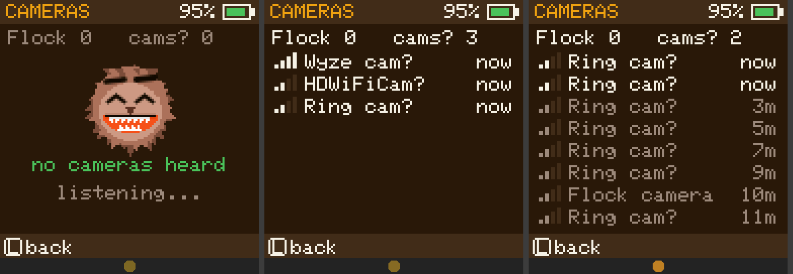

# Checkpoint 11: Hidden-camera hints

For checking a hotel room, rental or Airbnb: Jerry lists anything on Wi-Fi
that looks like a camera. It shares the **Cameras** screen with the Flock
detector. Listen-only.


*Simulator: nothing heard yet → at "home": a Wyze camera streaming, a spy
cam's HDWiFiCam hotspot, a Ring doorbell in setup mode → after the drive
(Flock camera + Ring doorbells passed).*

🎬 = a good moment to film.

## What counts as a hint

| Clue | Example | How |
|---|---|---|
| **A camera company's Wi-Fi** | Wyze, Ring, Hikvision, EZVIZ, Dahua, Reolink, Arlo, Axis, Amcrest, Swann, Lorex, Uniview, Canary, Hanwha, Reecam, Yoosee | 157 address prefixes from the official IEEE registry (`tools/make_camera_ouis.py`). Heard as a network, **or as a device sending Wi-Fi traffic**: a camera streaming video to the house Wi-Fi sends lots, and Jerry hears it during his listening window |
| **A spy / IP camera hotspot** | HDWiFiCam, V380 (`MV` + numbers), IPCAM, Yoosee (`GW_AP`), Lookcam, mini cam, "…camera…", Ring Setup, Tapo_Cam | Network names on every scan |

Hints are **quiet**: they're listed but don't pop up or light the LED (on a
drive you pass lots of doorbells). Flock cameras still pop up.

Only companies that mostly make cameras are included, matched on their
exact registered names. Generic chip makers are left out, so smart plugs
don't count.

## Flash it

1. GitHub Desktop: **Fetch origin** → **Pull origin**.
2. PowerShell in the repo folder:
   ```powershell
   powershell -ExecutionPolicy Bypass -File tools\flash_prebuilt.ps1 -Port COM7
   ```
   (Picks `jerryos-cp11-cams.bin`.)

## Using it (hotel / rental check)

1. Walk in, open **Menu → Cameras**, and wait **a minute**. Jerry
   listens in short bursts every 20 s, hopping channels.
2. Top line: `Flock 0   cams? N`. Each row shows the brand or hotspot, the
   signal bars and `now`.
3. **Walk around:** the bars grow as you get closer to the device. A camera
   in the bedroom shows much stronger than the doorbell outside.

## Tests

1. 🎬 **Your own camera** (Ring doorbell, Wyze, any of the brands above):
   stand near it, open Cameras, and wait a minute. It should show as "Ring cam?"
   etc. Walk away: the bars drop.
2. **At home with no cameras:** the list should be empty (or just
   neighbours' doorbells, weak).

## Limits (honest)

- **A hint is not proof**, and **no hint is not proof either.** Cameras
  that record to a memory card and never use Wi-Fi are invisible to radio.
  Cameras built on generic Wi-Fi chips don't carry a camera brand's address.
  Use your eyes too (smoke detectors, chargers, clocks facing the bed).
- 2.4 GHz only. A camera on 5 GHz Wi-Fi isn't heard.
