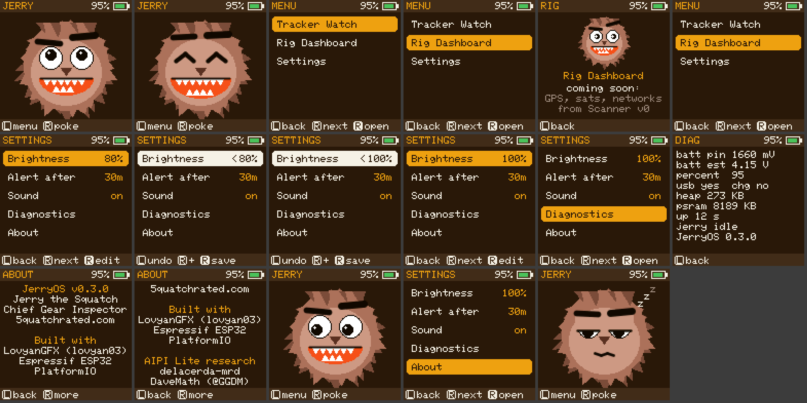

# Checkpoint 3: the JerryOS shell

Jerry's face on the home screen, a menu, a hint bar that always says what
the buttons do, a status bar, and switching between modes. Jerry is still
placeholder art drawn in code; the real art comes at Checkpoint 5.

🎬 = a good moment to film.


*Placeholder Jerry: alert, approved, idle, scanning, sleepy (rendered by the
simulator from the real firmware code).*


*Every screen, captured by the simulator while it pressed the buttons.*

---

## Flash it

1. GitHub Desktop: **Fetch origin** → **Pull origin**.
2. PowerShell in the repo folder (**Repository → Show in Explorer**, type
   `powershell` in the address bar):
   ```powershell
   powershell -ExecutionPolicy Bypass -File tools\flash_prebuilt.ps1 -Port COM7
   ```
   It picks the newest build (`jerryos-cp3-shell.bin`) automatically.

🎬 **Money shot:** Jerry appears for the first time. Give it 10 seconds:
he blinks and glances around on his own.

## The controls

| Button | Does |
|---|---|
| LEFT tap | open menu / go back |
| RIGHT tap | next option |
| RIGHT hold | select |
| LEFT hold | go home, from anywhere |

The **hint bar** at the bottom always shows what the buttons do *right now*.
An **outlined** letter box means *tap*; a **filled** box means *hold*.

## Things to try (and film)

1. 🎬 **Home:** watch Jerry blink and glance around. **Tap RIGHT** to poke
   him: he grins with happy eyes.
2. 🎬 **Menu:** tap LEFT. Tap RIGHT to move the gold bar, then hold RIGHT to
   open. Try **Rig Dashboard** ("coming soon") and **Tracker Watch** (comes
   alive at Checkpoint 4).
3. 🎬 **Settings → Brightness:** hold RIGHT to edit (the row turns cream),
   tap RIGHT to change it. The screen changes brightness **live**. Hold
   RIGHT to save (Jerry grins), or tap LEFT to undo.
4. **Unplug and replug USB:** the brightness setting should still be there.
   It's saved in flash.
5. 🎬 **Hold LEFT** from deep inside Settings → About: straight home.
6. **Plug USB in** while on battery: Jerry grins ("thanks for the juice").
7. 🎬 **Leave it alone for 2 minutes:** Jerry gets sleepy, with drooping
   eyelids and floating z's. Any button wakes him.
8. **Settings → Diagnostics:** live battery / USB / memory readings.

## What to send Claude

- Does anything look wrong or feel awkward (text cut off, colours, the
  button feel)?
- How does Jerry look on the real screen? (Photo!)
- Anything you'd change about the menu or hint bar before we build on it.
