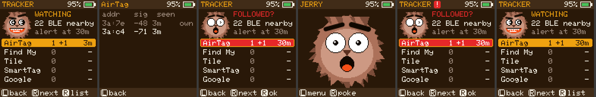
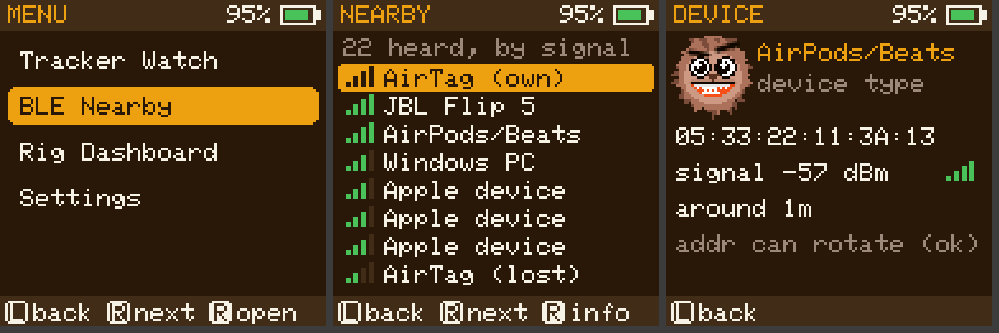

# Checkpoint 4: Tracker Watch

Jerry now listens for item trackers (AirTag, Find My, Tile, SmartTag,
Google) and warns you if one keeps up with you for the whole alert window.
New in v0.4.1, **BLE Nearby** shows every Bluetooth device he can hear.
How it works and its limits: [TRACKERS.md](TRACKERS.md).


*Simulator: watching → device list → alert (auto-opens) → home during alert
→ alert row → acknowledged.*

🎬 = a good moment to film.

## Flash it

1. GitHub Desktop: **Fetch origin** → **Pull origin**.
2. PowerShell in the repo folder:
   ```powershell
   powershell -ExecutionPolicy Bypass -File tools\flash_prebuilt.ps1 -Port COM7
   ```
   (Picks `jerryos-cp4-tracker.bin` automatically.)

## Reading the screen

```
 TRACKER            95% [##]
 (Jerry)  ALL CLEAR            <- or WATCHING / FOLLOWED?
          23 BLE nearby        <- proof the radio is listening
          alert at 30m         <- your Settings window
 AirTag     1 +1   12m         <- kind | lost ones now | +own ones | how long around
 Find My    0       -
 Tile       0       -
 SmartTag   0       -
 Google     0       -
 [L]back [R]next [R]list       <- filled R = hold
```

- **Middle numbers:** the bright number is trackers **away from their
  owner** (the ones that can alert). The dim **+N** is trackers **with their
  owner** nearby (your AirTag next to your iPhone, a passenger's keys).
  They're shown so you know Jerry sees them, but they never alert.
- **Jerry's face:** approved = all clear · scanning = separated trackers
  around but not following (yet) · alert = followed.
- **Hold R on a row** to list individual devices: short address, signal
  strength (closer = nearer 0, e.g. -45 vs -90), and how long seen. Tags
  with their owner show `own` and never alert.
- When an alert fires, the tracker screen **opens by itself**, the row goes
  red, and a red **!** blinks in the status bar on every screen. **Hold R**
  on the red row = "ok, I know" (quiet for one window).

## BLE Nearby (Menu → BLE Nearby)



Every Bluetooth LE device Jerry heard in the last minute, **closest
(strongest signal) first**, with phone-style signal bars.

```
 NEARBY             95% [##]
 18 heard, by signal
 ▂▄▆█ JBL Flip 5               <- it broadcasts its own name
 ▂▄▆█ AirPods/Beats            <- type worked out from the broadcast
 ▂▄▆_ Windows PC
 ▂▄__ Apple device             <- most iPhones/Macs/Watches look like this
 ▂___ Garmin                   <- only the maker is known (dim)
 ▂___ unknown                  <- sends no clues at all (dim)
 [L]back [R]next [R]info
```

- **Tap R** moves the highlight. **Hold R** opens that device: full address,
  signal in dBm, and how long it's been around. The signal updates live, so
  you can walk around and play "hotter / colder" to find it.
- The list re-sorts every 2 seconds, and signal is smoothed, so it doesn't
  jump around.

**Why so many say "Apple device" or "unknown":** phones, watches and laptops
don't broadcast their names, for privacy. Jerry only reads what devices
broadcast on their own; asking a device for its name would mean
transmitting, and Jerry never transmits. Many also **change their address**
every ~15 minutes, so the same phone can briefly show up twice.

## Tests

1. 🎬 **It's alive:** open Tracker Watch. Does "BLE nearby" show a number
   (phones, earbuds, cars...)? Walk around the house; it should change.
2. **Your own gear:** if you have an AirTag on you or your keys, the AirTag
   row should show **0 +1** (zero lost, one with its owner). Hold R on the
   row: it's listed as `own`.
3. 🎬 **What's around me:** Menu → **BLE Nearby**. Count the "Apple device"
   rows vs the iPhones in the room. Turn a Bluetooth speaker or earbuds on
   and watch it appear near the top. Hold R on it, walk away, watch the
   signal drop.
4. 🎬 **The real alert test (best video moment):**
   - Settings → **Alert after → 10m** (shorter test).
   - Separate an AirTag from its owner's iPhone: leave the iPhone at home or
     switch its Bluetooth off, and keep the AirTag next to Jerry.
   - Wait. After the AirTag notices it's alone (often 15+ min), it switches
     to its "separated" broadcast. Jerry goes to **WATCHING**, and 10 min later
     **FOLLOWED?** with the shocked face. Film the moment it flips!
   - Hold R on the red row to acknowledge.
   - Set Alert after back to **30m**.
5. **Serial log (optional):** `py -m serial.tools.miniterm COM7 115200`.
   Every 10 s you'll see `ble N nearby, X adverts, Y tracker`.

## Not in v0 yet

- **Sound:** the Settings switch exists, but the alert is visual for now.
  The speaker needs its audio chip (ES8311) set up; that's a follow-up.
