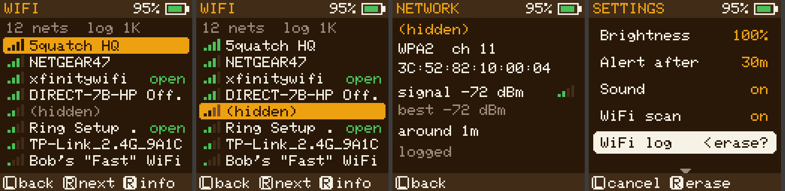

# Checkpoint 5: Wi-Fi Scanner + Logger

Jerry now listens for Wi-Fi networks too, shows them closest first, and
keeps a log of every network he's heard, saved on the device. Copy the log
to your PC as a spreadsheet file (CSV) with one command.


*Simulator: network list → highlight moves → one network's details →
Settings, erasing the log.*

🎬 = a good moment to film.

## Listen-only, like everything else

Every Wi-Fi router shouts its name (a "beacon") about 10 times a second
whether anyone's listening or not. Jerry just listens on each channel for a
moment. He **never** sends "who's out there?" requests (probe requests),
never joins a network, and never transmits anything. The ESP32-S3 only
hears **2.4 GHz** Wi-Fi; 5 GHz-only networks won't appear.

A full sweep of channels 1-13 takes about 1.5 s and happens every 20 s, in
the background, on every screen. Bluetooth (Tracker Watch) keeps listening
too; the two share the radio.

## Flash it

1. GitHub Desktop: **Fetch origin** → **Pull origin**.
2. PowerShell in the repo folder:
   ```powershell
   powershell -ExecutionPolicy Bypass -File tools\flash_prebuilt.ps1 -Port COM7
   ```
   (Picks `jerryos-cp5-wifi.bin` automatically.)
3. **The very first boot takes a little longer before networks show up.**
   Jerry formats his storage area once (left over from the stock firmware).
   The screen works normally meanwhile.

## The screens

**Menu → WiFi Scan**

```
 WIFI               95% [##]
 12 nets  log 3K               <- heard in the last 90 s | log file size
 ▂▄▆█ 5quatch HQ
 ▂▄▆_ xfinitywifi       open   <- green "open" = no password
 ▂▄__ (hidden)                 <- network that hides its name
 [L]back [R]next [R]info
```

- **Tap R** moves the highlight, **hold R** opens the network: name,
  security (open / WPA2 / WPA3...), channel, hardware address (BSSID),
  signal now and best, and how long it's been around. Signal updates live.

**Settings**: two new rows (the list scrolls now; a little ▼ means more below).

- **WiFi scan on/off**: off turns the Wi-Fi radio fully off and saves battery.
  Bluetooth Tracker Watch keeps working.
- **WiFi log**: shows the log size. **Hold R** → it asks `erase?` →
  **hold R again** to erase, or **tap L** to cancel.

## The log

Each network gets **one line the first time it's heard after power-on**.
Next power-on is a new "session", so a network you pass every day shows up
once per trip, not every 20 seconds.

| Column | Meaning |
|---|---|
| `session` | Power-on number. Each boot/trip gets a new one. |
| `uptime_s` | Seconds since that power-on when it was first heard |
| `bssid` | The router's hardware address |
| `ssid` | Network name (`""` = hidden) |
| `auth` | Security: open, WEP, WPA, WPA2, WPA3... |
| `channel` | 1-13 |
| `rssi` | Signal in dBm: -40 is right next to it, -90 is barely there |

**No date and no location yet.** The AIPI Lite has no clock and no GPS, so
the log says *how long after power-on*, not *when* or *where*. When the Rig
Dashboard links to the Scanner v0 (which has GPS), we can add both.

The log can grow to 3 MB (about 40,000 networks). At that point it stops
logging, and the WiFi screen says **log FULL**. Pull it and erase it.

### Copy the log to your PC

1. Plug Jerry in with USB. **Close any serial monitor** (only one program
   can use COM7 at a time).
2. In PowerShell, in the repo folder:
   ```powershell
   py tools\pull_wifi_log.py COM7
   ```
3. It saves `logs\wifi-<date>-<time>.csv`. Open it in Excel.

To save it **and then erase it from Jerry** in one go:

```powershell
py tools\pull_wifi_log.py COM7 --clear
```

The `logs` folder is ignored by git, so your logs never end up on GitHub.

## Tests

1. 🎬 **It sees Wi-Fi:** Menu → **WiFi Scan**. Your own network should be at
   or near the top. Do the names match what your phone's Wi-Fi list shows?
2. 🎬 **Hotter / colder:** hold R on your router, walk away, and watch the
   signal drop. Walk back, and it climbs.
3. **Settings → WiFi scan → off**, then save. WiFi Scan says "scan OFF".
   Turn it back on.
4. **Log survives power-off:** note the log size in Settings, switch Jerry
   off and on, and check the size is still there (it grows a bit with the
   new session).
5. 🎬 **Pull the log** with the command above and open it in Excel.
6. **Erase:** Settings → WiFi log → hold R, hold R again. The size goes
   back to ~1K.
7. **Nothing else broke:** Tracker Watch and BLE Nearby still show devices.

## Also over USB (optional)

In a serial terminal (`py -m serial.tools.miniterm COM7 115200`), type:

- `wifi dump` + Enter prints the whole log
- `wifi clear` + Enter erases it

The `[status]` line every 10 s now also shows
`wifi on N near, X seen, log Y B`.
