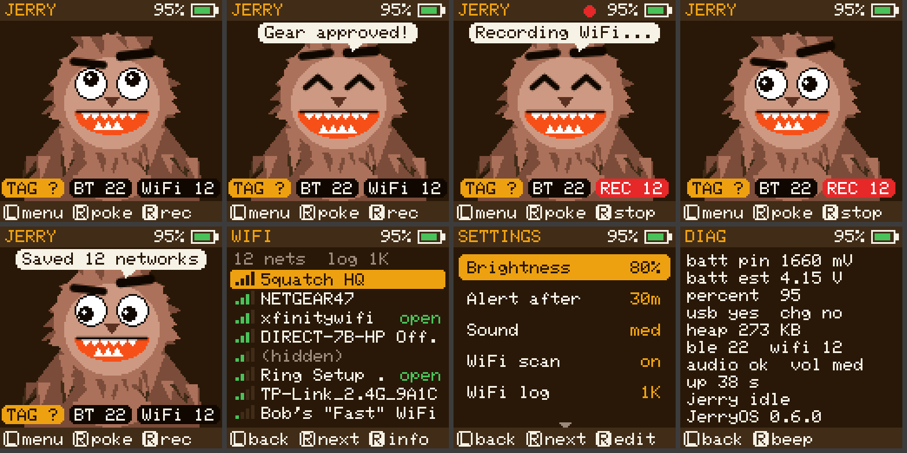

# Checkpoint 6: The personal monitor (home screen, REC, finishing touches)

JerryOS is now what it really is: a **personal, on-the-spot monitor** you
carry. It watches for trackers following you, shows the Bluetooth and Wi-Fi
around you, and **saves only when you tell it to.** Without GPS, a log
can't say *where* anyway, so recording is a choice, not the default. It's
also the handheld starting point for the Pi Zero box (Scanner v0).


*Simulator: home → poke → REC → recording → stop → WiFi Scan, Settings,
Diagnostics.*

🎬 = a good moment to film.

## Flash it

1. GitHub Desktop: **Fetch origin** → **Pull origin**.
2. PowerShell in the repo folder:
   ```powershell
   powershell -ExecutionPolicy Bypass -File tools\flash_prebuilt.ps1 -Port COM7
   ```
   (Picks `jerryos-cp6-monitor.bin` automatically.)
3. Jerry boots quietly to the home screen.

## What's new

### Home screen: everything at a glance

```
 JERRY            ● 95% [##]     <- red dot = recording the Wi-Fi log
     ( Gear approved! )          <- Jerry talks when you poke him
          (Jerry)
 [TAG ok] [BT 18] [WiFi 12]      <- trackers | Bluetooth nearby | Wi-Fi nearby
 [L]menu [R]poke [R]rec
```

- **TAG ok** (green) = no lost trackers around · **TAG ?** (gold) = a lost
  tracker is nearby, watching it · **TAG !** (red) = followed.
- **Tap R** = poke: Jerry grins and says something (some lines use
  live counts: "18 gadgets nearby").
- **Hold R = REC**: start saving Wi-Fi networks. The Wi-Fi pill turns red
  and counts what's been saved (`REC 34`), a red dot blinks at the top on
  every screen, and Jerry's eyes sweep while he records. **Hold R again** =
  stop ("Saved 34 networks").

### Recording is opt-in

- Scanning still runs all the time (you see networks live on WiFi Scan), but
  **nothing is saved until you press REC.** Every power-on starts with REC off.
- Each REC press starts a new **session** number in the log, so each
  recording (a drive, a walk, a campsite) can be told apart in Excel.
- Pressing REC saves everything in range straight away, then each new
  network as it appears. Each network is saved once per session.
- WiFi Scan's top line shows `REC 34` in red while recording; a network's
  detail page says `saved (REC)` or `not saved`.

### Silent and cute

Jerry is **silent** (v0.6.2). We tried beeps, then synthesized Sasquatch
sounds; neither fit, so sound is gone. Jerry reacts on screen instead:
grins, speech bubbles, the shocked face and the blinking red **!** for a
tracker alert. The speaker amp is held off, so there's no hiss and no
wasted battery. (The audio chip driver worked fine on the device; it's
kept in git history in case real voice lines are ever wanted.)

### Battery saver (screen)

On battery, the screen **dims after 1 minute** without a button press and
**turns off after 5 minutes**. Scanning, tracker watching and recording keep
running. **Any button wakes it** (that press only wakes; it doesn't also
do something). A tracker alert wakes it too. On USB the screen stays on.

### Also

- **About** says what Jerry is: a personal monitor, listen-only, saves only
  when you REC.
- Turning **WiFi scan** off in Settings also stops a recording.

## Tests

1. 🎬 **Poke:** tap R on home a few times. A grin and a new speech bubble each time.
2. **Pills:** BT and WiFi counts look sensible; TAG says ok.
3. 🎬 **REC:** hold R → "Recording WiFi...", red pill + red dot. Walk around a
   bit. Hold R → "Saved N networks". Pull the log
   (`py tools\pull_wifi_log.py COM7`): the newest lines share one session
   number.
4. **Screen saver:** unplug USB, don't touch anything. ~1 min: dims. ~5 min:
   off. Press a button: it comes back, and the press didn't do anything else.
5. **Nothing else broke:** Tracker Watch, BLE Nearby, WiFi Scan.
