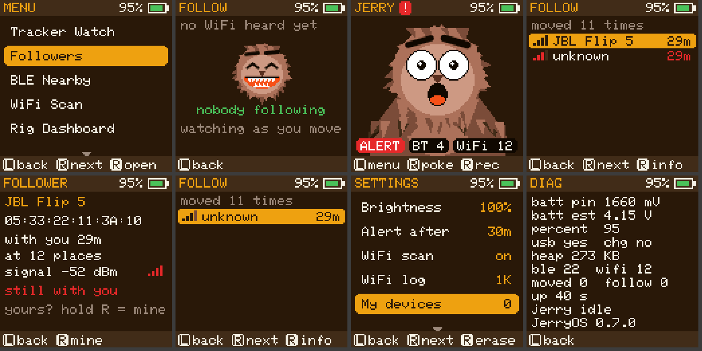

# Checkpoint 7: Followers ("is something following me?")

Tracker Watch catches AirTags, Tiles and other item trackers. **Followers**
catches *any* Bluetooth device that stays with you while you move: a car
behind you, a watch, a dashcam, a gadget slipped into a bag.


*Simulator: menu → nothing yet → (a 30-min "drive") home shows ALERT →
followers list → details → after "mine" on the speaker → Settings "My
devices" → Diagnostics.*

🎬 = a good moment to film.

## How Jerry knows

1. **"Have I moved?"** Every 20 s Jerry compares the Wi-Fi networks around
   you with the ones from before. When most are different (twice in a
   row), you're somewhere new: a new **place**. No GPS needed.
2. **"What's still with me?"** A Bluetooth device seen at **4+ places** over
   **20+ minutes** (never gone for more than 5 min) is a **follower**.
3. **Why 20 minutes:** phones, AirPods and watches change their Bluetooth
   address every ~15 minutes for privacy. Waiting longer than that keeps a
   passenger's phone from setting Jerry off.
4. **At home nothing moves**, so nothing is ever flagged there.

Trackers are left to Tracker Watch. Everything here is listen-only.

## Flash it

1. GitHub Desktop: **Fetch origin** → **Pull origin**.
2. PowerShell in the repo folder:
   ```powershell
   powershell -ExecutionPolicy Bypass -File tools\flash_prebuilt.ps1 -Port COM7
   ```
   (Picks `jerryos-cp7-followers.bin` automatically.)

## The screens

- **Home:** the first pill is now overall safety: **SAFE** (green),
  **WATCH** (gold: a lost tracker nearby, or devices tagging along), or
  **ALERT** (red: tracker or follower alert).
- **Menu → Followers:** top line says how many times you've moved. With no
  followers: "nobody following" (and how many are "tagging along" so far).
  With followers: one row each, with signal bars and how long it's been with
  you. Red = still with you right now.
- **Hold R on a follower** for details: name/type, address, how long, how
  many places, signal. **Hold R again = "mine"**: it's yours (your watch,
  your car), so Jerry never flags it again.
- **When a new follower is found:** the Followers screen opens by itself,
  the red **!** blinks in the status bar, and Jerry looks shocked. Opening
  the list counts as "seen".
- **Settings → My devices:** how many you've marked "mine". Hold R twice to
  clear the list.
- **Diagnostics:** `moved N  follow N`.

## Tests

1. **At home:** Menu → Followers says "nobody following" and `moved 0`
   (or a small number). Leave it for an hour: still nobody.
2. 🎬 **The drive test (best video):** take Jerry on a 30+ minute drive
   through town with Wi-Fi scan on. Watch "moved N times" go up.
   - Anything of yours that doesn't change its Bluetooth address (a Garmin,
     your car's system, a speaker in the car) should show up as a follower
     after ~20 min. Hold R → hold R = mine.
   - Your iPhone and AirPods shouldn't show up (they change address).
3. **Mine sticks:** after marking something "mine", power-cycle Jerry and
   check Settings → My devices still shows the count.

## Limits (honest)

- **Needs Wi-Fi scan on** and some Wi-Fi around to notice you've moved. On a
  long empty highway with no networks, Jerry can't tell you're moving.
- Devices that change address every few minutes can't be followed this
  way (that's the point of their privacy feature). AirTag-type trackers are
  covered by Tracker Watch instead.
- Real GPS (from the Pi Zero box later) will make "have I moved?" exact.
