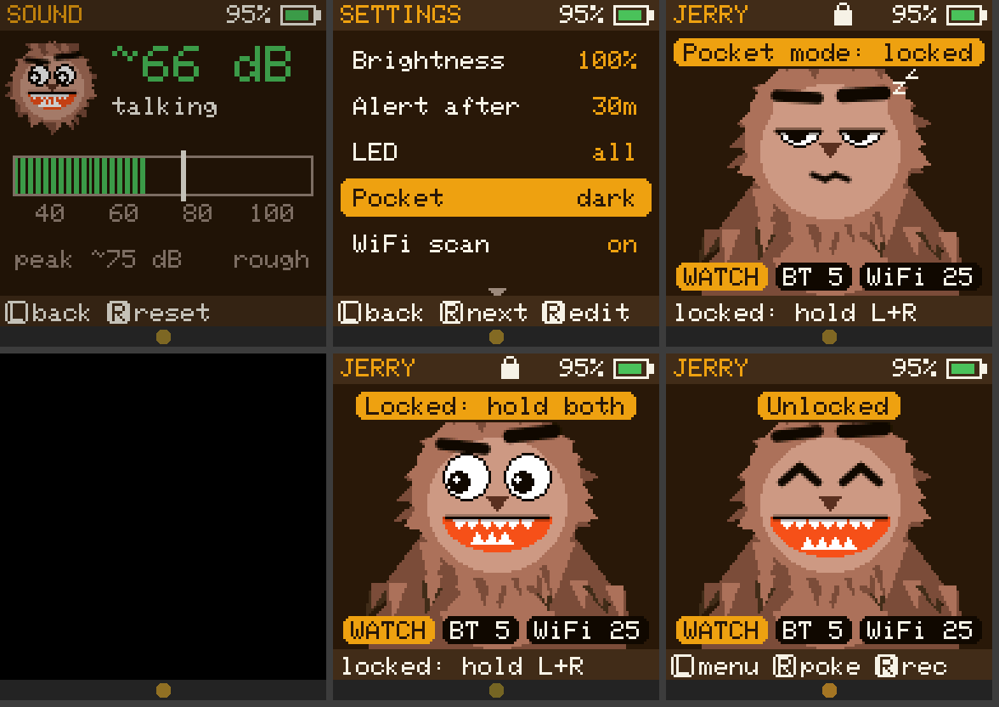

# Checkpoint 12: Pocket mode + sound meter

*Simulator: Sound meter → Settings "Pocket" → locked → screen dark → a
press peeks → unlocked.*

## Pocket mode

- **Hold both buttons for 1 second** = lock. Again = unlock.
- Locked: the buttons do nothing (no accidental presses in a pocket). A
  single press just **peeks** at the screen for 4 s ("Locked: hold both").
  A padlock shows top-right, and the bottom bar says `locked: hold L+R`.
- **Settings → Pocket:**
  - `dark` (default): while locked the screen stays **black**, even for
    alerts. The LED tells you (red blink = look).
  - `lit`: while locked, alerts still light the screen.
- Everything keeps scanning and watching while locked. It's only the buttons
  and the screen that are affected.
- Every power-on starts unlocked.

## Sound meter (Menu → Sound)

- The built-in microphone, used **only while this screen is open** (it
  switches itself off ~3 s after you leave). The speaker is never used.
- A big **~dB** number, an everyday word (quiet / talking / loud / very loud /
  painful), a meter bar 30-110 dB with a peak line, and **peak**. Hold R
  resets the peak.
- **Rough:** the microphone isn't calibrated. Compare with a sound-meter app
  on your phone and tell me both numbers; I'll tune it (one setting).
- The screen doesn't dim while you're watching the meter.
