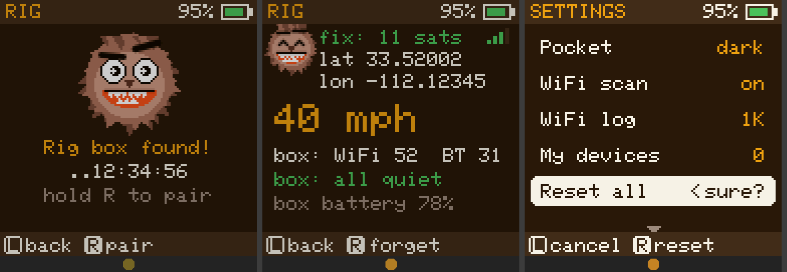

# Checkpoint 13: v1.0 (Rig Dashboard, GPS-tagged logs, reset, user guide)

*Simulator: a rig box is found → paired and connected (GPS fix, 40 mph, the
box's counts) → Settings "Reset all" asking first.*

## What's new

- **Rig Dashboard is real.** The Pi Zero box broadcasts a status beacon
  (`tools/pi/jerry_beacon.py`); Jerry listens, pairs with your box (hold R)
  and shows GPS fix, satellites, lat/lon, speed in mph, the box's Wi-Fi /
  Bluetooth / alert counts and its battery. Strangers' beacons are ignored.
- **REC logs where.** While the paired box has a fresh GPS fix, every Wi-Fi
  log line gets `lat,lon`. Older logs on the device are converted once
  (two empty columns added) so the CSV stays tidy.
- **Settings → Reset all** (asks first): wipes settings, the "mine" list,
  the rig pairing and the Wi-Fi log, then restarts.
- **[User guide](../USER-GUIDE.md):** everything on one page.

## Test

See the **v1.0** section of [TEST-PLAN.md](../TEST-PLAN.md).
