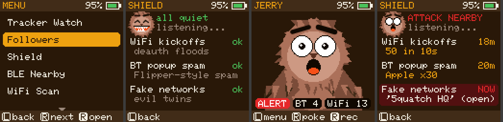

# Checkpoint 8: Shield (radio attack detector)

Jerry now watches for people messing with the radios around you. Still
**listen-only**: he never sends anything.


*Simulator: menu → Shield, all quiet → home during an attack → Shield
after a Flipper burst (minute 10), a kick-off flood (12) and an evil twin
(15+, still happening).*

🎬 = a good moment to film.

## What it catches

| Row | What's happening | How Jerry knows |
|---|---|---|
| **WiFi kickoffs** | Someone floods fake "disconnect" messages to knock cameras, doorbells or phones off their Wi-Fi (a "deauth" attack) | After each Wi-Fi scan, he listens to raw Wi-Fi traffic for ~6.5 s, hopping channels 1-13. 30+ disconnect frames in 10 s = flood |
| **BT popup spam** | A Flipper Zero (or a phone app) spraying fake "connect your AirPods / Galaxy Buds / earbuds / keyboard" pop-ups | 12+ *different* addresses sending pop-up broadcasts within 10 s. Your own AirPods are one address, so they never count |
| **Fake networks** | An **evil twin**: an open copy of a network name that's normally locked (people join it thinking it's the real one). Or **one box broadcasting 8+ network names** (a "Pineapple"-style trap) | Checked on every Wi-Fi scan |

When something starts, the **Shield** screen opens by itself, the red **!**
blinks, Jerry looks shocked, and home says **ALERT**. While it's still
going, home stays **WATCH**. A threat is "over" after a calm minute (3 min
for fake networks).

## Flash it

1. GitHub Desktop: **Fetch origin** → **Pull origin**.
2. PowerShell in the repo folder:
   ```powershell
   powershell -ExecutionPolicy Bypass -File tools\flash_prebuilt.ps1 -Port COM7
   ```
   (Picks `jerryos-cp8-shield.bin` automatically.)

## Reading the Shield screen

```
 SHIELD             95% [##]
 (Jerry) all quiet                <- or ATTACK NEARBY
         listening...
 WiFi kickoffs              ok    <- ok / NOW (red) / 18m (last seen, gold)
  deauth floods                   <- what it watches for, or the last details
 BT popup spam              ok
  Flipper-style spam
 Fake networks              ok
  evil twins
 [L]back
```

## Tests

1. **Quiet day:** Menu → Shield says "all quiet", all rows **ok**. Leave
   Jerry on for a few hours at home and around town: it should stay quiet.
   (If something trips with nothing going on, tell me which row and the
   detail line, and I'll tune it.)
2. **Nothing else got worse:** BLE Nearby and Tracker Watch still find the
   same number of devices as before. (Wi-Fi now listens a bit longer each
   cycle and shares the radio with Bluetooth.)
3. 🎬 **If you have (or know someone with) a Flipper Zero:** run its
   Bluetooth "Apple/Android pop-up spam". Jerry should go **ATTACK NEARBY**
   within seconds with "Apple x__" (only test on your own gear).
4. 🎬 **Evil twin, safely:** turn on your phone's hotspot **with no password**
   and name it exactly like your home Wi-Fi. Within a minute: **Fake
   networks NOW**, "'YourWiFi' (open)". Turn the hotspot off after.

## Limits

- 2.4 GHz only (the chip can't hear 5 GHz Wi-Fi).
- Kick-off listening covers ~6.5 s of every 20 s, so a very short burst can
  be missed. Real attacks usually last much longer.
- Offices and campuses can have one access point with up to ~6 network
  names; the "many names" rule needs 8+ so they don't trip it.
