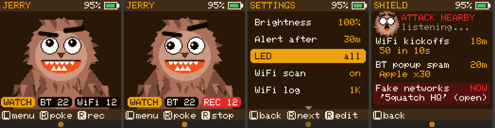

# Checkpoint 9: The colour LED as a silent signal

The AIPI Lite has one small colour LED that was never used. Now it tells
you what's going on, **even with the screen off**, so you can glance at
Jerry on the dash or clipped to a bag.


*Simulator (the dot under each screen is the LED): watching (amber) →
recording → Settings LED row → during an attack.*

## What the colours mean

| LED | Meaning |
|---|---|
| 🔴 **red, fast blink** | **Look at Jerry.** A new alert: tracker, follower or attack. Stops once you've looked at that screen |
| 🟠 **amber, slow pulse** | **Watching.** Something's around: a lost tracker nearby, a listed follower, or an attack still going |
| 🔵 **blue blip every 3 s** | Recording the Wi-Fi log (REC) |
| 🟢 **soft green breath** | All clear (only when LED is set to **all**) |
| off | LED switched off, or nothing to say in **alerts** mode |

Everything is kept dim: the LED is very bright up close.

**Settings → LED:** `all` (default) / `alerts` (only red, amber and blue,
dark when all is clear, good for night) / `off`. While editing, the LED
shows the change straight away.

## Flash it

1. GitHub Desktop: **Fetch origin** → **Pull origin**.
2. PowerShell in the repo folder:
   ```powershell
   powershell -ExecutionPolicy Bypass -File tools\flash_prebuilt.ps1 -Port COM7
   ```
   (Picks `jerryos-cp9-led.bin` automatically.)

## Tests

1. **Where is it?** After flashing, look for a soft **green** breathing
   light. Tell me where on the device it is and how it looks (too bright,
   too dim, hard to see?).
2. **Colours right?** Green should look green. If it looks **red** instead,
   the LED wants its colours in a different order. Tell me and I'll swap
   them (one line).
3. 🎬 **REC:** hold R on home: a short **blue** blip every 3 s.
4. **Settings → LED → alerts:** the green goes dark; → **off**: everything off.
   Set it back to what you like.
5. 🎬 **Alert:** the evil-twin hotspot test from Checkpoint 8 (open hotspot
   named like your home Wi-Fi) should make the LED **blink red** until you
   look at Shield, then **pulse amber** while the hotspot is still on.
